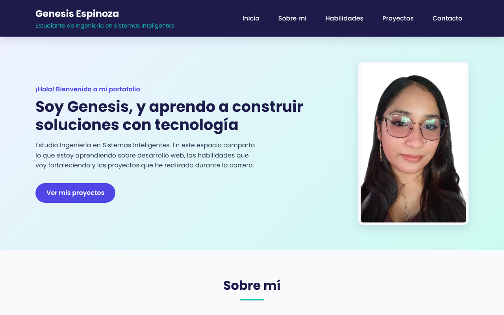

# Portafolio Personal

**Estudiante:** Genesis Espinoza
**Asignatura:** Programación de Sistemas Web — Actividad Integradora 1
**Universidad:** Universidad ECOTEC

## Descripción

Sitio web que funciona como mi portafolio personal. Presenta quién soy, mis
habilidades, algunos proyectos realizados durante la carrera y una sección de
contacto con un formulario visual (el formulario no envía información).

## Secciones

1. Encabezado con nombre, carrera y menú de navegación
2. Sección principal con título, descripción e imagen
3. Sobre mí
4. Habilidades
5. Proyectos
6. Contacto
7. Pie de página

## Tecnologías utilizadas

- **HTML5** con etiquetas semánticas (`header`, `nav`, `main`, `section`, `article`, `footer`)
- **CSS3** en un archivo externo (`styles.css`) con variables en `:root`, Flexbox, efectos `:hover` y diseño adaptable
- **Git y GitHub** para el control de versiones
- **Visual Studio Code** como editor de código

## Estructura del proyecto

```
portafolio-personal/
├── index.html
├── styles.css
├── README.md
└── img/
    ├── avatar.svg
    ├── captura-portafolio.png
    ├── proyecto-bienvenida.svg
    ├── proyecto-portafolio.svg
    └── proyecto-tarjeta.svg
```

## Cómo visualizar el proyecto

**Opción 1 — En línea (GitHub Pages):**
https://geespino.github.io/portafolio-personal/

**Opción 2 — En tu computadora:**

1. Descarga el repositorio con el botón **Code → Download ZIP** y descomprímelo
   (o clónalo con `git clone https://github.com/geespino/portafolio-personal.git`).
2. Abre el archivo `index.html` con doble clic en tu navegador.
3. También puedes abrir la carpeta en Visual Studio Code y usar la extensión **Live Server** (clic derecho en `index.html` → **Open with Live Server**).

## Captura de pantalla


